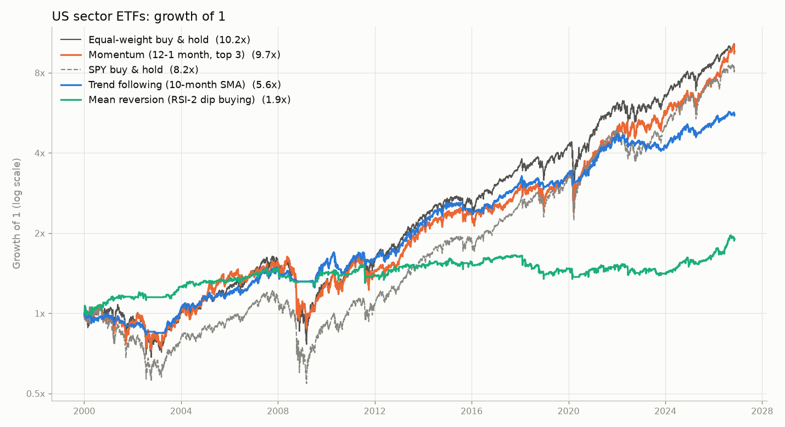
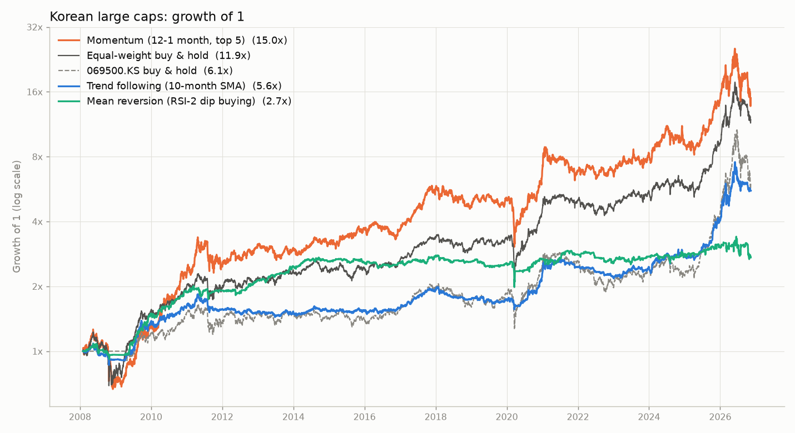

# stockprj: 검증된 퀀트 전략 3종 백테스트

학계와 업계에서 오래 연구된 대표 전략 3가지를 구현하고, 과거 데이터로 성과를 비교합니다.
모든 실행은 GitHub Actions에서 이루어지므로 PC에 아무것도 설치할 필요가 없습니다.

> 이 저장소는 **과거 데이터 검증(백테스트)까지만** 합니다. 실제 주문을 내는 기능은 아직 없습니다.
> 과거 성과는 미래 수익을 보장하지 않으며, 이 문서는 투자 권유가 아닙니다.

## 전략 3종

| 전략 | 한 줄 설명 | 매매 주기 | 근거 |
|:---|:---|:---|:---|
| **추세추종** | 월말 종가가 10개월 이동평균보다 높은 종목만 보유하고, 아니면 그 몫은 현금 | 월 1회 | Faber (2007), Moskowitz·Ooi·Pedersen (2012) |
| **모멘텀** | 최근 12개월(직전 1개월 제외) 수익률 상위 1/3 종목을 같은 비중으로 보유 | 월 1회 | Jegadeesh·Titman (1993), Moskowitz·Grinblatt (1999) |
| **평균회귀** | 200일 이동평균 위에 있는 종목이 단기 급락(RSI(2) < 10)하면 사고, 5일 이동평균을 넘으면 매도 | 매일 | Jegadeesh (1990), Lehmann (1990), Connors·Alvarez (2009) |

매개변수는 원 논문·저서의 값을 그대로 썼고, 결과를 보고 조정하지 않았습니다.
공매도와 레버리지는 쓰지 않습니다. 구현은 [`quant/strategies.py`](quant/strategies.py)에 있습니다.

비교 기준은 두 가지입니다.

- **동일비중 보유**: 같은 종목들을 똑같이 나눠 사서 그냥 들고 있는 것. 전략이 "종목을 고르고 타이밍을 잡은" 효과를 보려면 이것과 비교해야 합니다.
- **시장 지수**: S&P 500, KOSPI.

## 결과 (2026-11-11 실행)

### 미국 섹터 ETF 9종, 2000-01 ~ 2026-11 (26.9년)

| | 추세추종 | 모멘텀 | 평균회귀 | 동일비중 보유 | S&P 500 |
|:---|---:|---:|---:|---:|---:|
| 연평균 수익률 | 6.6% | 8.8% | 2.4% | 9.0% | 8.2% |
| 최대 낙폭 | -18.1% | -46.3% | -18.7% | -53.3% | -55.2% |
| 샤프 비율 | 0.69 | 0.54 | 0.33 | 0.57 | 0.51 |
| 1원 → | 5.58원 | 9.66원 | 1.90원 | 10.16원 | 8.25원 |



### 한국 대형주 15종, 2005-02 ~ 2026-11 (21.8년)

| | 추세추종 | 모멘텀 | 평균회귀 | 동일비중 보유 | KOSPI (배당 제외) |
|:---|---:|---:|---:|---:|---:|
| 연평균 수익률 | 10.9% | 17.1% | 6.7% | 15.2% | 8.4% |
| 최대 낙폭 | -27.0% | -50.2% | -28.6% | -43.7% | -54.5% |
| 샤프 비율 | 0.81 | 0.71 | 0.58 | 0.78 | 0.48 |
| 1원 → | 9.52원 | 30.83원 | 4.08원 | 21.98원 | 5.79원 |



한국 쪽은 "지금 유명한 대형주"를 골라 넣은 것이라 모든 수익률이 실제보다 부풀려져 있습니다.
절대 수치가 아니라 전략끼리의 상대 비교로만 보세요.

연도별 수익률, 기간별 성과, 가정을 바꿨을 때의 결과는 상세 보고서에 있습니다.

- [미국 섹터 ETF 보고서](results/us_sectors/report.md)
- [한국 대형주 보고서](results/kr_largecap/report.md)

## 해석

1. **수익률만 보면 어떤 전략도 "그냥 사서 보유"를 뚜렷하게 이기지 못했습니다.**
   미국에서는 세 전략 모두 동일비중 보유(연 9.0%)보다 낮았고, 한국에서는 모멘텀만 조금 높았습니다(17.1% 대 15.2%).
2. **추세추종의 가치는 수익이 아니라 손실 방어입니다.**
   수익률은 보유보다 낮지만 최대 낙폭이 미국 -18% 대 -53%, 한국 -27% 대 -44%로 훨씬 작고,
   위험 대비 수익(샤프 비율)은 두 시장 모두에서 가장 높았습니다. 거래 비용이나 체결 시점을 바꿔도 결과가 거의 변하지 않습니다.
   대신 한국의 2010~2019년(연 2.3% 대 8.0%)처럼 오래 뒤처지는 구간이 있습니다.
3. **모멘텀은 수익이 가장 높지만 낙폭도 시장만큼 큽니다.**
   미국에서는 동일비중 보유와 사실상 같은 성과였고, 한국의 초과 수익은 편향된 표본에서 나온 것이라 그대로 믿기 어렵습니다.
4. **평균회귀는 거래 비용에 무너집니다.**
   연 40배 가까이 사고팔기 때문에, 비용이 0이면 연 6.8%(미국)·13.0%(한국)이던 수익이
   현실적인 비용에서 2.4%·6.7%로 줄고, 비용이 3배가 되면 손실로 바뀝니다.

처음 자동매매를 만든다면 **추세추종**이 가장 무난한 출발점입니다.
한 달에 한 번만 매매하고, 규칙이 단순하며, 비용과 체결 가정에 가장 덜 민감했습니다.

## 가정과 한계

- 체결: 종가로 신호를 계산하고 **다음 거래일 종가**에 체결. 거래 비용은 매수·매도 각각 미국 0.10%, 한국 0.15%.
- 현금 이자는 0%로 두었습니다. 현금 비중이 큰 추세추종과 평균회귀는 실제로는 이자만큼 더 나을 수 있습니다.
- 세금(양도소득세, 배당소득세)과 환율 변동은 반영하지 않았습니다.
- 데이터는 Yahoo Finance 무료 데이터입니다. 작업 중 결함 두 건을 발견해 피해 갔습니다
  (KODEX 200의 긴 공백, 2004년 이전 SK하이닉스의 0 이하 가격). 이런 값이 있으면 실행이 중단되도록 해 두었지만,
  걸러지지 않은 오류가 더 있을 수 있습니다.
- 마지막 날 데이터는 실행 시점에 장이 열려 있었다면 장중 가격입니다. 보고서의 "가장 최근 목표 비중"은 참고용입니다.
- 한 가지 매개변수, 두 가지 종목군만 시험했습니다.

## 실행 방법 (PC 불필요)

1. GitHub 저장소의 **Actions** 탭 → **backtest** → **Run workflow**
2. 최신 가격으로 다시 계산하려면 "가격 데이터를 새로 내려받기"를 체크
3. 몇 분 뒤 `results/` 폴더의 보고서와 차트가 자동으로 갱신됩니다

코드나 설정을 수정해 커밋해도 자동으로 실행됩니다.
종목을 바꾸려면 [`configs/`](configs)의 JSON 파일을 고치거나 새로 추가하면 됩니다.

## 구조

```
configs/            종목군 설정 (종목, 비교 지수, 거래 비용, 시작일)
quant/data.py       가격 내려받기, 캐시, 데이터 점검
quant/strategies.py 전략 3종 + 비교 기준
quant/backtest.py   백테스트 엔진 (거래 비용, 체결 지연)
quant/metrics.py    성과 지표
quant/report.py     보고서와 차트
run_backtest.py     실행 스크립트
tests/              단위 테스트 (미래 정보를 쓰지 않는지 등)
data/               내려받은 가격 (재현용 캐시)
results/            보고서, 차트
```

## 용어

- **연평균 수익률 (CAGR)**: 매년 같은 비율로 불어났다고 쳤을 때의 연 수익률.
- **최대 낙폭 (MDD)**: 가장 높았던 시점 대비 가장 크게 빠진 비율. -50%면 자산이 한때 반 토막 났다는 뜻.
- **샤프 비율**: 수익률을 변동성으로 나눈 값. 같은 위험으로 얼마나 벌었는지를 나타내며 높을수록 좋습니다.
- **bp**: 0.01%. 10bp = 0.10%.
- **생존 편향**: 지금까지 살아남은 종목만으로 과거를 시험해서 성과가 부풀려지는 현상.
