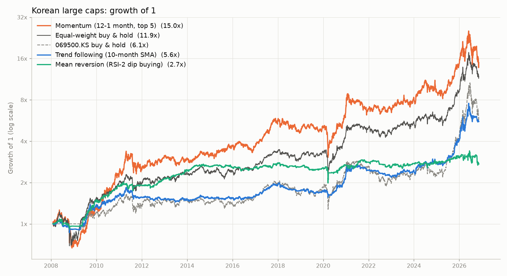
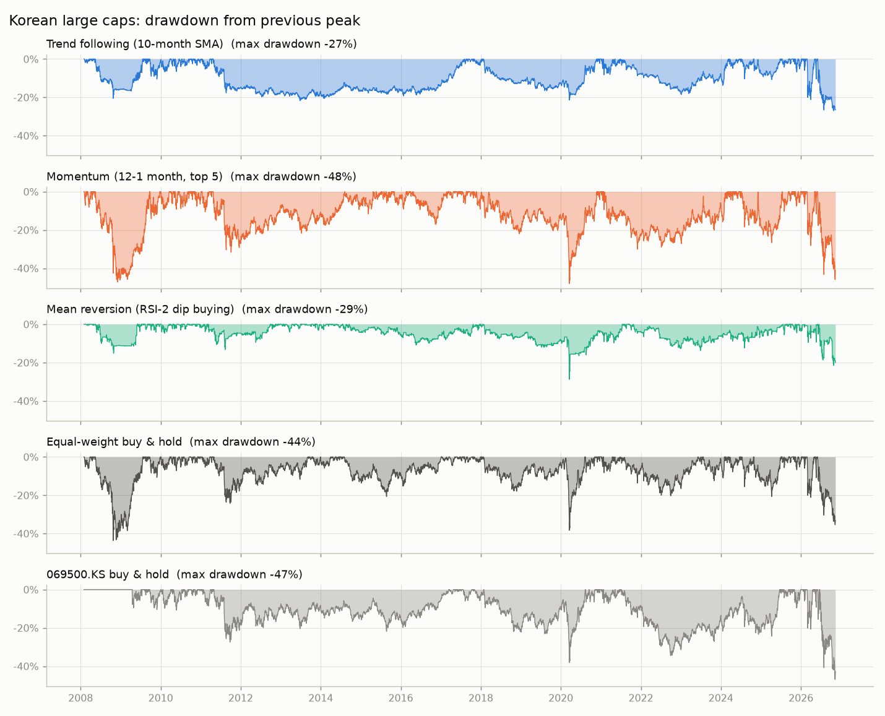

# 백테스트 결과: 한국 대형주 15종 (KOSPI)

- 평가 기간: 2008-02-01 ~ 2026-11-11 (18.8년)
- 대상 종목 15개: 005930.KS(삼성전자), 000660.KS(SK하이닉스), 005380.KS(현대차), 000270.KS(기아), 005490.KS(POSCO홀딩스), 051910.KS(LG화학), 006400.KS(삼성SDI), 012330.KS(현대모비스), 055550.KS(신한지주), 017670.KS(SK텔레콤), 033780.KS(KT&G), 015760.KS(한국전력), 066570.KS(LG전자), 000810.KS(삼성화재), 010130.KS(고려아연)
- 거래 비용: 매수·매도 각각 15bp (0.15%)
- 체결 가정: 종가로 신호 계산 → 다음 거래일 종가에 체결
- 현금 이자 0%, 세금(양도소득세·배당소득세) 미반영, 공매도·레버리지 없음
- 데이터: Yahoo Finance 수정 종가 (배당·분할 반영)
- **주의**: 이 15종목은 '오늘 기준으로 유명한 대형주'를 고른 것입니다. 과거에 컸다가 사라진 회사가 빠져 있으므로 모든 수익률이 실제보다 좋게 나옵니다(생존 편향). 전략끼리의 상대 비교용으로만 보세요.
- **주의**: 거래 비용 15bp는 수수료와 매도 시 증권거래세를 매수·매도에 나눠 반영한 근사값입니다.

## 1. 요약

| 지표 | 추세추종 | 모멘텀 | 평균회귀 | 동일비중 보유 | KOSPI 200 지수 |
|:---|---:|---:|---:|---:|---:|
| 1원이 몇 원이 되었나 | 5.56원 | 14.96원 | 2.72원 | 11.85원 | 6.09원 |
| 연평균 수익률 (CAGR) | 9.6% | 15.5% | 5.5% | 14.1% | 10.1% |
| 연 변동성 | 14.1% | 28.2% | 12.4% | 21.9% | 22.1% |
| 샤프 비율 | 0.73 | 0.66 | 0.50 | 0.72 | 0.55 |
| 최대 낙폭 (MDD) | -27.0% | -48.0% | -28.7% | -43.7% | -46.9% |
| CAGR ÷ MDD | 0.35 | 0.32 | 0.19 | 0.32 | 0.22 |
| 전고점 회복까지 최장 기간 | 6.2년 | 3.2년 | 3.6년 | 2.5년 | 5.8년 |
| 최악의 해 수익률 | -10.7% | -30.6% | -10.4% | -22.8% | -24.1% |
| 수익이 난 해의 비율 | 63% | 68% | 63% | 74% | 63% |
| 평균 투자 비중 | 56% | 100% | 27% | 100% | 100% |
| 연 회전율 (매수+매도) | 2.3배 | 5.0배 | 36.2배 | 0.7배 | 0.0배 |

## 2. 연도별 수익률

| 연도 | 추세추종 | 모멘텀 | 평균회귀 | 동일비중 보유 | KOSPI 200 지수 |
|:---|---:|---:|---:|---:|---:|
| 2008 | -8.5% | -30.6% | -3.8% | -22.8% | 0.0% |
| 2009 | 50.4% | 96.0% | 55.5% | 101.1% | 21.7% |
| 2010 | 16.5% | 64.6% | 25.9% | 27.6% | 23.9% |
| 2011 | -2.4% | 11.2% | 1.7% | -1.3% | -10.7% |
| 2012 | -2.6% | 25.5% | 11.9% | 11.7% | 11.3% |
| 2013 | 0.4% | -3.3% | 15.7% | 9.2% | 1.1% |
| 2014 | -0.0% | 4.0% | 5.3% | -1.9% | -6.6% |
| 2015 | 1.2% | 18.9% | -1.2% | 4.4% | -0.1% |
| 2016 | 2.3% | -2.5% | -0.3% | 8.0% | 10.2% |
| 2017 | 22.2% | 54.9% | 7.7% | 29.1% | 27.1% |
| 2018 | -9.9% | -15.8% | -6.2% | -11.8% | -17.3% |
| 2019 | -0.3% | 8.0% | -1.4% | 12.5% | 14.4% |
| 2020 | 31.3% | 34.2% | 4.8% | 34.5% | 35.5% |
| 2021 | 7.8% | -1.0% | 4.8% | 9.6% | 3.0% |
| 2022 | -10.7% | -0.9% | -9.1% | -9.4% | -24.1% |
| 2023 | 12.2% | 23.8% | 7.6% | 23.5% | 24.6% |
| 2024 | 11.3% | 9.9% | 2.1% | 2.5% | -9.4% |
| 2025 | 47.9% | 59.7% | 8.3% | 61.6% | 94.2% |
| 2026 | 37.1% | 2.0% | -10.4% | 28.5% | 40.0% |

첫 해와 마지막 해는 일부 기간만 포함합니다.

## 3. 기간별 성과 (연평균 수익률 / 최대 낙폭)

| 기간 | 추세추종 | 모멘텀 | 평균회귀 | 동일비중 보유 | KOSPI 200 지수 |
|:---|---:|---:|---:|---:|---:|
| 2008~2009 | 18.2% / -21% | 17.4% / -47% | 23.4% / -15% | 25.9% / -44% | 10.8% / -10% |
| 2010~2019 | 2.3% / -22% | 14.2% / -32% | 5.5% / -13% | 8.0% / -24% | 4.3% / -27% |
| 2020~2026 | 18.6% / -27% | 17.2% / -46% | 0.9% / -24% | 20.3% / -38% | 18.9% / -47% |

## 4. 가정을 바꿨을 때: 연평균 수익률 (샤프 비율)

| 체결 시점, 비용 | 추세추종 | 모멘텀 | 평균회귀 |
|:---|---:|---:|---:|
| 다음 날 종가, 편도 0bp | 10.0% (0.76) | 16.4% (0.69) | 11.4% (0.95) |
| 다음 날 종가, 편도 15bp | 9.6% (0.73) | 15.5% (0.66) | 5.5% (0.50) |
| 다음 날 종가, 편도 45bp | 8.8% (0.68) | 13.8% (0.61) | -5.4% (-0.39) |
| 당일 종가, 편도 0bp | 9.9% (0.75) | 15.4% (0.66) | 17.1% (1.33) |
| 당일 종가, 편도 15bp | 9.5% (0.73) | 14.6% (0.63) | 10.9% (0.90) |
| 당일 종가, 편도 45bp | 8.7% (0.68) | 12.9% (0.58) | -0.6% (0.01) |

## 5. 가장 최근 목표 비중 (참고)

- **추세추종** (2026-11-11 기준): 전액 현금
- **모멘텀** (2026-11-11 기준): 005930.KS 20%, 000660.KS 20%, 006400.KS 20%, 017670.KS 20%, 066570.KS 20%
- **평균회귀** (2026-11-09 기준): 033780.KS 20%, 000810.KS 20%, 현금 60%

## 6. 데이터 점검

- 5거래일 넘게 가격이 비어 있는 종목: ['069500.KS']
- 051910.KS: 하루 35% 초과 변동 1회 (2009-04-20)
