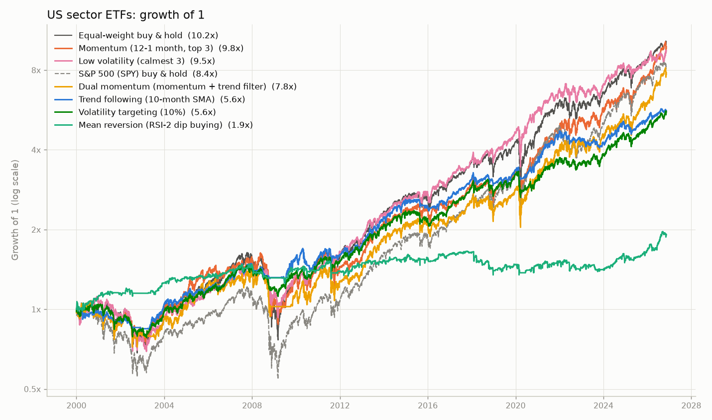
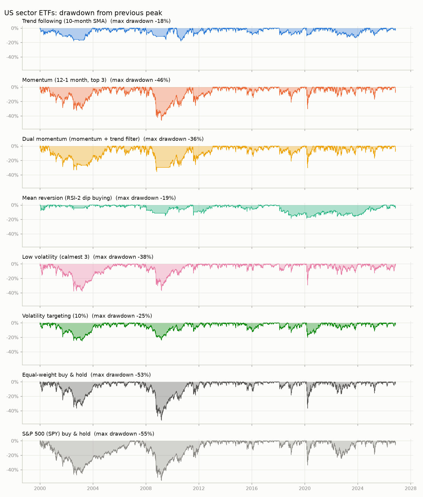

# 백테스트 결과: 미국 섹터 ETF 9종 (Select Sector SPDR)

- 평가 기간: 2000-01-03 ~ 2026-11-11 (26.9년)
- 대상 종목 9개: XLB(소재), XLE(에너지), XLF(금융), XLI(산업재), XLK(기술), XLP(필수소비재), XLU(유틸리티), XLV(헬스케어), XLY(경기소비재)
- 거래 비용: 매수·매도 각각 10bp (0.10%)
- 체결 가정: 종가로 신호 계산 → 다음 거래일 종가에 체결
- 현금 이자 0%, 세금(양도소득세·배당소득세) 미반영, 공매도·레버리지 없음
- 데이터: Yahoo Finance 수정 종가 (배당·분할 반영)
- **주의**: 9개 ETF는 1998년에 함께 상장된 전체 묶음이라, 지금 잘나가는 종목만 골라 넣는 편향(생존 편향)이 없습니다. 원화 투자자가 겪는 환율 변동은 반영하지 않았습니다.

## 1. 요약

| 지표 | 추세추종 | 모멘텀 | 듀얼 모멘텀 | 평균회귀 | 저변동성 | 변동성 조절 | 동일비중 보유 | S&P 500 지수 |
|:---|---:|---:|---:|---:|---:|---:|---:|---:|
| 1원이 몇 원이 되었나 | 5.62원 | 9.82원 | 7.83원 | 1.91원 | 9.47원 | 5.58원 | 10.25원 | 8.36원 |
| 연평균 수익률 (CAGR) | 6.6% | 8.9% | 8.0% | 2.4% | 8.7% | 6.6% | 9.1% | 8.2% |
| 연 변동성 | 10.1% | 18.9% | 17.4% | 8.2% | 15.0% | 10.8% | 18.1% | 19.2% |
| 샤프 비율 | 0.69 | 0.55 | 0.53 | 0.34 | 0.64 | 0.65 | 0.57 | 0.51 |
| 최대 낙폭 (MDD) | -18.1% | -46.3% | -35.6% | -18.6% | -38.0% | -25.2% | -53.3% | -55.2% |
| CAGR ÷ MDD | 0.37 | 0.19 | 0.22 | 0.13 | 0.23 | 0.26 | 0.17 | 0.15 |
| 전고점 회복까지 최장 기간 | 3.9년 | 4.0년 | 4.7년 | 8.2년 | 4.7년 | 3.8년 | 3.5년 | 6.6년 |
| 최악의 해 수익률 | -10.1% | -30.3% | -25.7% | -14.2% | -20.1% | -15.0% | -35.2% | -36.8% |
| 수익이 난 해의 비율 | 70% | 78% | 78% | 63% | 85% | 74% | 78% | 78% |
| 평균 투자 비중 | 72% | 100% | 92% | 27% | 100% | 76% | 100% | 100% |
| 연 회전율 (매수+매도) | 2.0배 | 5.3배 | 5.2배 | 41.7배 | 1.5배 | 1.8배 | 0.3배 | 0.0배 |

## 2. 연도별 수익률

| 연도 | 추세추종 | 모멘텀 | 듀얼 모멘텀 | 평균회귀 | 저변동성 | 변동성 조절 | 동일비중 보유 | S&P 500 지수 |
|:---|---:|---:|---:|---:|---:|---:|---:|---:|
| 2000 | -0.3% | -0.4% | -0.4% | 11.9% | 11.6% | 3.8% | 2.8% | -8.8% |
| 2001 | -9.4% | -8.0% | -10.9% | 3.0% | -14.5% | -10.8% | -6.8% | -11.8% |
| 2002 | -7.0% | -12.8% | -9.9% | -0.2% | -20.1% | -10.8% | -18.4% | -21.6% |
| 2003 | 24.3% | 28.9% | 15.0% | 9.4% | 22.0% | 18.8% | 28.3% | 28.2% |
| 2004 | 11.0% | 12.2% | 12.2% | 5.3% | 14.1% | 12.5% | 14.1% | 10.7% |
| 2005 | 1.3% | 17.3% | 17.3% | -0.1% | 9.4% | 4.8% | 7.9% | 4.8% |
| 2006 | 12.0% | 4.2% | 4.2% | 6.4% | 11.0% | 15.4% | 16.2% | 15.8% |
| 2007 | 11.6% | 9.3% | 9.3% | 4.8% | 11.3% | 6.4% | 9.5% | 5.1% |
| 2008 | -10.1% | -30.3% | -25.7% | -10.9% | -19.8% | -15.0% | -35.2% | -36.8% |
| 2009 | 17.8% | 20.8% | 12.0% | 8.6% | 15.4% | 13.4% | 28.2% | 26.4% |
| 2010 | 0.1% | 13.5% | 13.5% | -1.5% | 7.5% | 7.7% | 16.1% | 15.1% |
| 2011 | 3.2% | -2.5% | -2.5% | -0.8% | 15.4% | 2.4% | 3.1% | 1.9% |
| 2012 | 7.4% | 7.3% | 7.3% | 5.1% | 9.6% | 11.6% | 14.7% | 16.0% |
| 2013 | 29.7% | 38.2% | 38.2% | 4.5% | 27.6% | 24.0% | 30.9% | 32.3% |
| 2014 | 14.6% | 10.3% | 10.3% | 2.6% | 13.7% | 10.3% | 13.3% | 13.5% |
| 2015 | -4.8% | 1.5% | 1.6% | -0.5% | 4.6% | -5.8% | -1.3% | 1.2% |
| 2016 | 7.3% | 6.3% | 4.8% | 2.8% | 12.1% | 10.9% | 14.4% | 12.0% |
| 2017 | 17.9% | 14.5% | 14.5% | 1.6% | 17.9% | 19.2% | 19.2% | 21.7% |
| 2018 | -2.9% | -9.0% | -9.0% | -14.2% | 3.2% | -3.9% | -6.3% | -4.6% |
| 2019 | 12.1% | 25.6% | 23.0% | 5.4% | 24.8% | 17.0% | 27.7% | 31.2% |
| 2020 | 8.0% | 16.4% | 13.4% | -0.3% | 21.1% | -4.6% | 10.1% | 18.3% |
| 2021 | 28.6% | 23.2% | 23.2% | 3.6% | 20.7% | 20.4% | 29.7% | 28.7% |
| 2022 | -6.7% | 9.3% | 7.2% | -6.0% | -0.2% | -5.1% | -5.2% | -18.2% |
| 2023 | -2.0% | 10.1% | 7.4% | -1.3% | 3.6% | 9.5% | 13.9% | 26.2% |
| 2024 | 13.5% | 10.9% | 11.2% | 8.2% | 11.4% | 14.2% | 15.7% | 24.9% |
| 2025 | 6.6% | 17.0% | 17.0% | 9.2% | 8.9% | 8.9% | 13.4% | 17.7% |
| 2026 | 9.0% | 31.8% | 31.8% | 14.7% | 10.7% | 16.6% | 18.2% | 12.3% |

첫 해와 마지막 해는 일부 기간만 포함합니다.

## 3. 기간별 성과 (연평균 수익률 / 최대 낙폭)

| 기간 | 추세추종 | 모멘텀 | 듀얼 모멘텀 | 평균회귀 | 저변동성 | 변동성 조절 | 동일비중 보유 | S&P 500 지수 |
|:---|---:|---:|---:|---:|---:|---:|---:|---:|
| 2000~2009 | 4.5% / -18% | 2.7% / -46% | 1.4% / -36% | 3.6% / -15% | 2.9% / -38% | 3.2% / -25% | 2.7% / -53% | -0.9% / -55% |
| 2010~2019 | 7.8% / -18% | 9.7% / -26% | 9.3% / -26% | 0.3% / -19% | 13.3% / -13% | 8.9% / -14% | 12.4% / -19% | 13.3% / -19% |
| 2020~2026 | 7.8% / -14% | 17.0% / -30% | 15.9% / -30% | 3.9% / -10% | 11.0% / -29% | 8.2% / -20% | 13.5% / -37% | 14.8% / -34% |

## 4. 가정을 바꿨을 때: 연평균 수익률 (샤프 비율)

| 체결 시점, 비용 | 추세추종 | 모멘텀 | 듀얼 모멘텀 | 평균회귀 | 저변동성 | 변동성 조절 |
|:---|---:|---:|---:|---:|---:|---:|
| 다음 날 종가, 편도 0bp | 6.8% (0.71) | 9.5% (0.57) | 8.5% (0.56) | 6.8% (0.85) | 8.9% (0.65) | 6.8% (0.66) |
| 다음 날 종가, 편도 10bp | 6.6% (0.69) | 8.9% (0.55) | 8.0% (0.53) | 2.4% (0.34) | 8.7% (0.64) | 6.6% (0.65) |
| 다음 날 종가, 편도 30bp | 6.2% (0.65) | 7.7% (0.49) | 6.9% (0.47) | -5.8% (-0.68) | 8.4% (0.62) | 6.2% (0.61) |
| 당일 종가, 편도 0bp | 7.0% (0.72) | 9.6% (0.58) | 8.9% (0.58) | 5.9% (0.73) | 9.0% (0.65) | 7.0% (0.68) |
| 당일 종가, 편도 10bp | 6.8% (0.70) | 9.0% (0.55) | 8.3% (0.55) | 1.6% (0.23) | 8.8% (0.64) | 6.8% (0.66) |
| 당일 종가, 편도 30bp | 6.3% (0.66) | 7.8% (0.49) | 7.2% (0.49) | -6.6% (-0.80) | 8.5% (0.62) | 6.4% (0.63) |

## 5. 가장 최근 목표 비중 (참고)

- **추세추종** (2026-11-11 기준): XLB 11%, XLE 11%, XLF 11%, XLK 11%, XLP 11%, XLV 11%, XLY 11%, 현금 22%
- **모멘텀** (2026-11-11 기준): XLB 33%, XLE 33%, XLK 33%
- **듀얼 모멘텀** (2026-11-11 기준): XLB 33%, XLE 33%, XLK 33%
- **평균회귀** (2026-11-10 기준): 전액 현금
- **저변동성** (2026-11-11 기준): XLF 33%, XLP 33%, XLU 33%
- **변동성 조절** (2026-11-11 기준): XLB 7%, XLE 7%, XLF 7%, XLI 7%, XLK 7%, XLP 7%, XLU 7%, XLV 7%, XLY 7%, 현금 37%

## 6. 데이터 점검

- 공통 시작일 1998-12-22 (가장 늦게 시작하는 종목: XLB)
